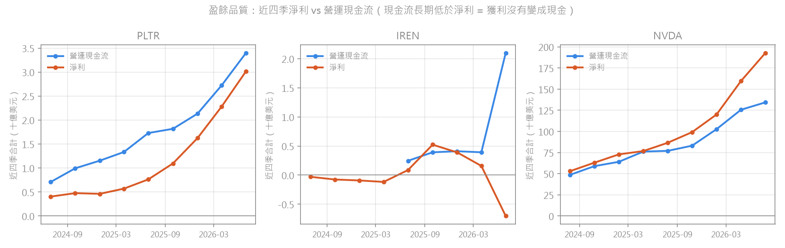

# C07 Financial Data Collection

> ⚠️ Disclaimer: all strategy analysis and backtest results on this page are for educational and research purposes only and do not constitute investment advice or any guarantee of returns.

## Requirements

- Collect financial statement data with Akshare, Tushare or QMT
- Table: `trade_stock_financial` (quarterly financials)
- **The course uses QMT/Akshare; this version uses Moomoo instead**: `get_financials_statements` (through C04's `quantlib/data`), with yfinance for public reproduction.

## Method

- **Symbols**: `US.PLTR`, `US.IREN`, `US.NVDA`, the latest 12 quarters from Moomoo.
- **Pipeline**:

```
quantlib.data.get_financials (UTC+8 period-end fix, paging, rate limits) → schema validation
  → financial_items (raw long table; old values go to financial_revisions when a value changes)
  → config/financial_fields.yaml candidate-field matching (period ends aligned by fiscal period)
  → quarterly values → trailing twelve months (TTM) → ratios
  → SEC EDGAR filing dates → available_date
  → financial_metrics → VIEW trade_stock_financial (course-compatible)
```

- **Candidate fields** (the course's `get_field`, p.46): each metric lists candidate `(statement, field_id)` pairs in priority order. If none is found, the value stays empty and is logged in the report — no estimating, no guessing.
- **Trailing twelve months (TTM)**: calculated only when four consecutive quarters all have values; one missing quarter leaves it empty. Ratios such as ROE and gross margin use TTM. ROE stays empty when equity is negative; the earnings-quality ratio stays empty when net income is negative.
- **Available date (`available_date`)**: financial statements carry a period-end date but no release date.
  - First choice: **the day after the original SEC 10-Q/10-K filing date** from EDGAR.
  - Fallback: period end + 46 days for a quarter, + 76 days for fiscal Q4.
- **Schedule**: re-fetched automatically every Saturday at 07:00 Taipei time (`scripts/run_weekly_financials.ps1`); restatements are recorded.
- **Run**: `lessons/L04-data-pipeline/C07-financial-data-collection/src/ingest_financials.py`; shared code lives in `quantlib/fundamentals/` and `quantlib/data/edgar.py`.

### Differences from the course version

| Issue | Course version | This version |
|---|---|---|
| Release timing | Report period (`report_date`) only | Adds `available_date` (the day after the SEC filing). PLTR's 2026 Q2 ended on 06-30 but was filed on 08-04; backtesting on the period end would see the results five weeks early |
| Restatements | `ON DUPLICATE KEY UPDATE` overwrites | Old values are written to `financial_revisions` before overwriting, so a backtest can restore "the numbers as seen at the time" |
| Ratio basis | Single period | Trailing twelve months (quarterly flow items are single-quarter values, so dividing them directly distorts ratios); quarterly gross and net margins are kept separately |
| Field matching | Candidate column names | Candidate `(statement, field_id)` pairs: `field_id` is unique only within one statement (for example, 8015 is Other Taxes on the income statement but Operating Cash Flow on the cash flow statement) |
| Inconsistent period ends | Not handled | When statements disagree on the period end for the same fiscal period, the majority date is used and the correction is logged |
| Percentages | Stored as percentages | Stored as decimals; the course-compatible view multiplies by 100 |

## Results

### Data completeness

| Symbol | Quarters | Period | Line items | EDGAR matched | Notes |
|---|---|---|---|---|---|
| PLTR | 12 | 2023-09-30 to 2026-06-30 | 986 | 12 / 12 | All fields present |
| IREN | 13 | 2023-06-30 to 2026-06-30 | 1,124 | 5 / 13 | Files 10-Q/10-K only from FY2026; earlier it was a foreign private issuer (20-F/6-K), so the conservative fallback applies |
| NVDA | 12 | 2023-10-29 to 2026-07-26 | 1,165 | 12 / 12 | FY2025 Q1 period end corrected (see below) |

- Two consecutive runs recorded zero restatements, so the load is idempotent (re-running does not change the result).
- **Data-source issues, all logged rather than hidden:**
  - **IREN's early quarters lack some fields**: four quarters from 2023-09 to 2024-06 have no `8001` total revenue, so the second candidate `8002` Total Operating Revenue is used. Those four quarters plus 2023-06 (five in all) have no operating cash flow field. It could be derived from the cash identity, but the result does not reconcile with Moomoo's free cash flow — the gap equals the FX effect — so it is left empty.
  - **NVDA inconsistent period end**: for FY2025 Q1 the income statement says 2024-04-27 while the balance sheet and cash flow statement say 2024-04-28 (the actual quarter end); both are aligned to 04-28.
  - **The two sources disagree**: IREN's FY2025 Q4 free cash flow is −US$255m on Moomoo and +US$49m on yfinance (yfinance is missing operating cash flow for that quarter).

### Latest period (trailing twelve months)

| Symbol | Period end | Available | Revenue | Net income | Operating cash flow | ROE | Gross margin | OCF ÷ net income | Debt ratio | Current ratio |
|---|---|---|---|---|---|---|---|---|---|---|
| PLTR | 2026-06-30 | 2026-08-05 | 6.16bn | 3.02bn | 3.40bn | 30.5% | 84.8% | 1.13 | 15.4% | 7.23 |
| IREN | 2026-06-30 | 2026-08-28 | 0.71bn | −0.70bn | 2.10bn | −16.8% | 62.3% | — (negative net income) | 73.5% | 3.55 |
| NVDA | 2026-07-26 | 2026-08-27 | 302.97bn | 192.88bn | 134.36bn | 84.2% | 74.7% | 0.70 | 28.5% | 4.59 |

Amounts in US dollars.



### Earnings quality (course p.45: is profit turning into cash?)

- **PLTR**: operating cash flow has stayed above net income throughout, a sign of good earnings quality. The ratio fell from 2.3 in mid-2025 to 1.13 because net income grew faster. [Inference] Stock-based compensation is a non-cash expense that lifts operating cash flow above net income, and it is a large share of PLTR's costs.
- **NVDA**: net income has mostly exceeded operating cash flow over the past two years, and the gap widened in 2026, with the latest ratio at 0.70. By the course's p.45 standard, that is a signal worth tracking. [Inference] Receivables and inventory may be absorbing cash during rapid revenue growth; the next step is to check those balance sheet items.
- **IREN**: TTM net income has turned negative, yet operating cash flow jumped to US$1.81bn in the latest quarter (Moomoo and yfinance agree), while capital expenditure that quarter was US$1.98bn. [Inference] This may relate to customer prepayments; the 10-K is needed to confirm.

## Risk checklist

- [x] Data leakage and look-ahead bias: every period has an `available_date`, so a backtest may only use statements with `available_date ≤ that day`; pre-restatement values are kept separately.
- [x] Survivorship bias: only three watchlist stocks here; market-wide research should use the delisting fields in `instruments`.
- [ ] Overfitting and out-of-sample testing: no strategy in this check-in.
- [ ] Transaction costs and slippage: no trading in this check-in.
- [ ] Liquidity constraints and market impact: no trading in this check-in.

## Limitations and reflections

- The available date is based on the SEC filing date, which comes days or weeks after the earnings release, so it is deliberately conservative. A strategy that trades the reaction on results day would need the release date separately.
- Before FY2026, IREN was a foreign private issuer (filing on 20-F/6-K), so Moomoo's early quarterly figures may not be on the same basis as its later 10-Q filings; use them with care.
- Only the latest 12 quarters are fetched, so TTM figures start in 2024. A longer history needs annual reports or SEC XBRL financial data.
- (To be completed: personal reflections)
