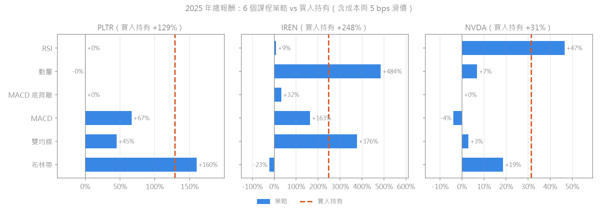
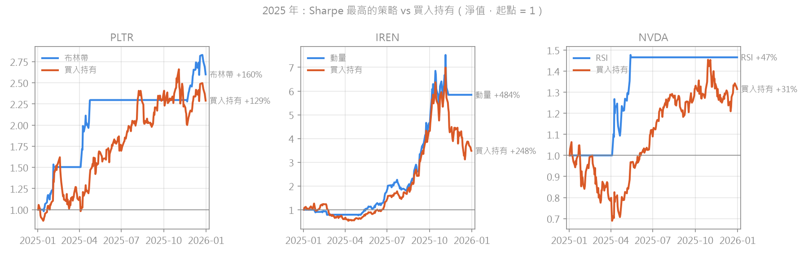
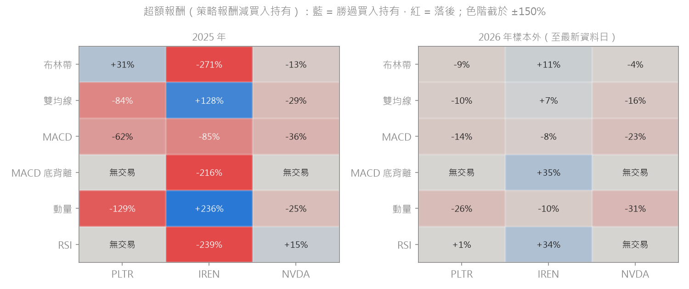

# C13 搭建你的股票交易回測

> ⚠️ 免責聲明：本頁所有策略分析與回測結果僅供教育與研究用途，不構成投資建議或收益保證。

## 題目要求

- 你的自選股在 2025 年採用哪種交易策略是適合的？
  - 可用自選股，也可用貴州茅台
  - 候選策略：雙均線、MACD、RSI、布林帶、動量、MACD 底背離
  - 你為什麼覺得哪種策略最能體現當年的交易行情？
- 課件示例（茅台 2025，初始資金 1,000,000、手續費萬分之 2、倉位 95%）：總收益率 −8.94%、最大回撤 10.36%（課件數據，非本人回測結果）
- 對應 CASE：`CASE-Backtrader回测/1-双均线策略.py` ～ `7-自定义策略.py`、`1b-摩擦成本与成交约束.py`

## 方法

- **資料**：C06 寫入 MySQL 的 Moomoo 前復權日線。標的為 `US.PLTR`、`US.IREN`、`US.NVDA`。
- **兩段期間**：
  - **2025 年**（2025-01-02 ～ 2025-12-31）：回答課程題目。
  - **2026 年樣本外**（2026-01-02 ～ 2026-10-16）：檢驗「2025 年的冠軍策略」到了下一年還有沒有效。
  - 兩段都先用前一年的資料暖機，確保 30 日指標已經算好；暖機期不交易。
- **策略**：6 個課程策略，**參數一律用課程預設值，不針對 2025 年調整**，避免事後最佳化。每檔另跑「買入持有」當基準。
- **交易設定**：初始資金 10,000 美元、每次進場用 95% 資金、整數股。

```
MySQL market_daily → quantlib/strategies（6 個外掛策略，自動載入）
  → quantlib/backtest（Backtrader：t+1 開盤成交、美股成本、滑價、成交量上限）
  → 績效指標（由每日淨值自行計算）→ 圖表 + metrics.json
```

### 和課程版本不同的地方

| 項目 | 課程版本 | 本人版本 |
|---|---|---|
| 交易成本 | 單一費率萬分之 2（A 股） | 美股成本分項：佣金、平台費、賣出時的 SEC 費與 FINRA TAF；監管費率依**成交日期**套用當時的費率（SEC 費在 2025-05-14 降為 0，2026-04-04 又調升） |
| 滑價 | 主程式沒有設定 | 開盤成交價加 5 bps，並做 0／5／10／20 bps 敏感度分析 |
| 成交量限制 | 1b 有示範（每根 K 線 10%） | 所有策略都套用 |
| A 股規則 | T+1、漲跌停 | 美股沒有這些限制，已移除 |
| 股數 | 可有小數股 | 整數股 |
| 績效指標 | Backtrader 分析器 | 由每日淨值自行計算，並與 QuantStats 交叉驗證（Sharpe、Sortino、最大回撤一致） |
| 基準 | 無 | 每檔都和買入持有比較；另做樣本外檢驗 |

成本費率來源：Moomoo Canada 官方公開費率（每股佣金 0.0049 美元、最低 0.99；平台費每股 0.005、最低 1.00）；SEC 費率依 SEC 公告；FINRA TAF 2026 年費率尚待 FINRA 官方公告確認（詳見 `config/costs.yaml`）。

## 結果



### 2025 年（報酬／Sharpe／最大回撤／平倉筆數）

| 策略 | PLTR | IREN | NVDA |
|---|---|---|---|
| **買入持有** | +128.9% / 1.61 / 39.4% / — | +248.2% / 1.82 / 57.7% / — | +31.5% / 0.83 / 35.2% / — |
| 雙均線 | +44.9% / 0.97 / 36.4% / 5 | +376.3% / 2.58 / 39.3% / 3 | +2.9% / 0.26 / 35.7% / 4 |
| MACD | +66.7% / 1.33 / 25.4% / 9 | +163.1% / 1.73 / 47.7% / 8 | −4.0% / 0.02 / 32.0% / 10 |
| RSI | 無交易 | +8.8% / 0.42 / 33.5% / 1 | **+46.6% / 1.69 / 13.7% / 1** |
| 布林帶 | **+159.9% / 2.69 / 8.1% / 2** | −22.9% / −0.28 / 35.8% / 1 | +18.6% / 0.66 / 31.9% / 3 |
| 動量 | −0.2% / 0.27 / 50.1% / 6 | **+484.3% / 2.98 / 25.3% / 5** | +6.8% / 0.38 / 28.8% / 4 |
| MACD 底背離 | 無交易 | +32.3% / 1.07 / 20.2% / 2 | 無交易 |

粗體為該檔 Sharpe 最高的策略。



### 2026 年樣本外：2025 年的冠軍沒有延續



| 標的 | 2025 冠軍 | 2025 超額報酬 | 2026 同策略報酬 | 2026 買入持有 | 2026 超額報酬 |
|---|---|---|---|---|---|
| PLTR | 布林帶 | +31% | −2.9% | +6.2% | **−9%** |
| IREN | 動量 | +236% | −49.4% | −39.6% | **−10%** |
| NVDA | RSI | +15% | 無交易（0%） | +11.3% | **−11%** |

### 交易成本敏感度（2025 年）

- 以 1 萬美元本金計算，一整年的成本約 4～125 美元。從「完全不計成本」到「成本 + 20 bps 滑價」，大部分策略的報酬減少不到 6 個百分點（IREN 動量因為本金已放大數倍，減少約 14 個百分點），**每檔的策略排名都沒有改變**。
- 唯一的例外是 IREN 的 MACD：滑價 20 bps 時，報酬反而從 +161% 升到 +210%。原因是 2025-01-17 的買單因為「跳空 + 滑價」讓 95% 倉位的資金不夠而被拒，剛好避開了一筆虧損交易，之後每筆交易的股數也跟著改變。這是**路徑依賴（Path Dependence）**，不是成本帶來的好處。

## 交易員觀點：哪種策略最能體現 2025 年的行情？

**沒有單一答案，要看每檔股票當年的行情型態。**

- **IREN：持續性的強趨勢 → 趨勢跟蹤勝出。** 買入持有 +248%，動量與雙均線分別達到 +484%、+376%，而且最大回撤比買入持有小。均值回歸策略（布林帶、RSI）在強趨勢中不斷「太早賣出」，布林帶甚至虧損 23%。
- **PLTR、NVDA：上升趨勢中夾著幾次急跌後 V 型反彈 → 逢低買進的均值回歸勝出。** PLTR 的布林帶只交易 2 次，剛好買在 1 月和 4 月兩次急跌的低點；NVDA 的 RSI 全年只有 1 筆交易，買在 4 月的超賣區。【推論】4 月那次低點與 4 月初關稅消息引發的全面下跌時點相符。
- **但這些「冠軍」大多是運氣成分很高的少數幾筆交易。** PLTR 布林帶的 +160% 來自 2 筆交易，NVDA RSI 只有 1 筆。樣本這麼少，Sharpe 再高也沒有統計意義。

**樣本外檢驗印證了這一點：** 2026 年三檔的「2025 冠軍」全部落後買入持有 9～11 個百分點。用 2025 年的結果挑 2025 年最好的策略，是事後解釋，不是可以拿來交易的預測。

## 風險檢查表

- [x] 資料洩漏（Data Leakage）與前視偏差（Look-ahead Bias）：訊號用 t 日收盤價計算，t+1 日開盤才成交（有單元測試驗證）；暖機期不交易。前復權在 2025–2026 年間沒有分割，影響很小。
- [x] 倖存者偏差（Survivorship Bias）：3 檔都是現在仍在交易、而且 2025 年大漲的自選股，結論**不能推廣到全市場**。
- [x] 過度擬合（Overfitting）與樣本外測試（Out-of-sample Testing）：參數不調整；6 個策略 × 3 檔 = 18 次嘗試，挑最好的那個本身就是多重比較（Multiple Testing）；2026 樣本外結果顯示冠軍策略沒有延續。
- [x] 交易成本（Transaction Costs）與滑價（Slippage）：美股成本分項計算，並做 0～20 bps 敏感度分析。
- [x] 流動性限制（Liquidity Constraints）與市場衝擊（Market Impact）：每根 K 線最多成交當天成交量 10%；以 1 萬美元本金計算，這 3 檔的流動性綽綽有餘。

## 限制與心得

- 每檔只有 1～10 筆交易，樣本太少，任何單一策略的好壞都無法下統計結論。之後的 C17、C21 要用更多標的或更長期間。
- 95% 倉位遇到跳空時會被拒單，造成路徑依賴（例如 IREN MACD）。之後的策略題改用「保留緩衝的倉位」或「以開盤價計算股數」。
- MACD 底背離在 PLTR、NVDA 全年都沒有觸發：課程的寬鬆背離條件（MACD > 前低 × 0.8）在上升趨勢中很少成立。程式忠實照課程寫，不另外修改。
- 成本費率用的是 Moomoo Canada 的公開費率，確認自己帳戶的方案後，要在 `config/costs.yaml` 新增一組設定再重跑。
- （待你補充：自己的心得）
